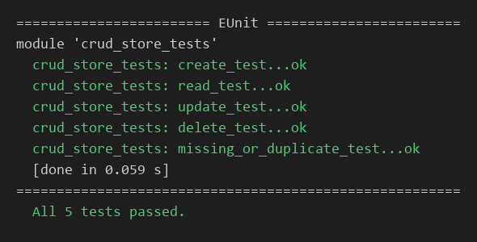
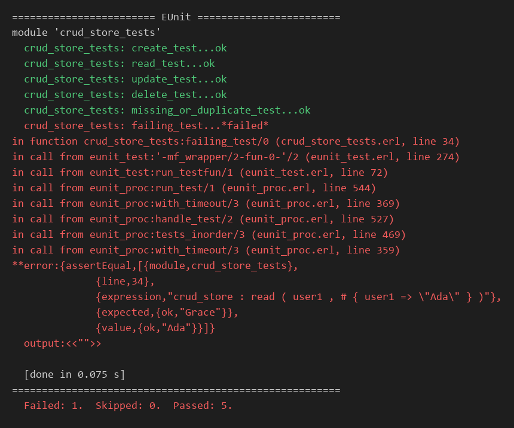

# Erlang CRUD Example

A small Erlang example demonstrating CRUD operations—Create, Read, Update, and Delete—using an immutable map as an in-memory store. Each write operation returns a new map; it does not modify the original.

## Requirements

- Erlang/OTP with EUnit

## Files

- `crud_store.erl` — CRUD operations
- `crud_store_tests.erl` — EUnit tests

## Compile and run tests

From the directory containing both files:

```sh
erlc crud_store.erl crud_store_tests.erl
erl -noshell -eval "case eunit:test(crud_store_tests, [verbose]) of ok -> halt(0); _ -> halt(1) end."
```

Expected output when all tests pass:



Example output when a test fails (a deliberately failing test added temporarily; it is not part of this repository):



The colors in these images were added for readability; EUnit itself prints plain text.